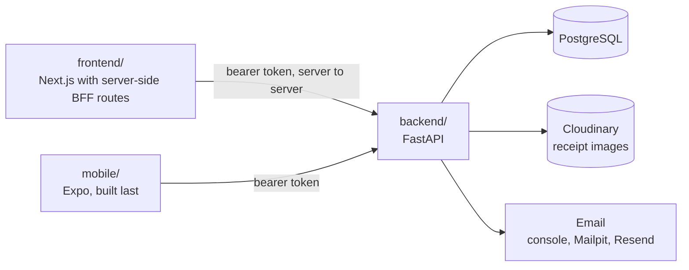
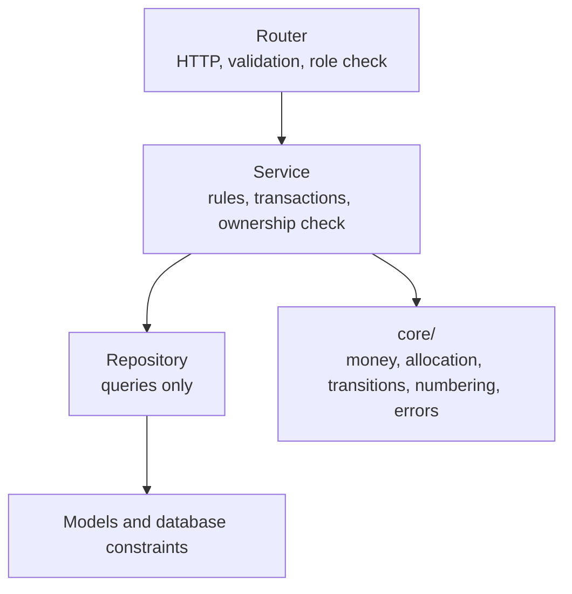
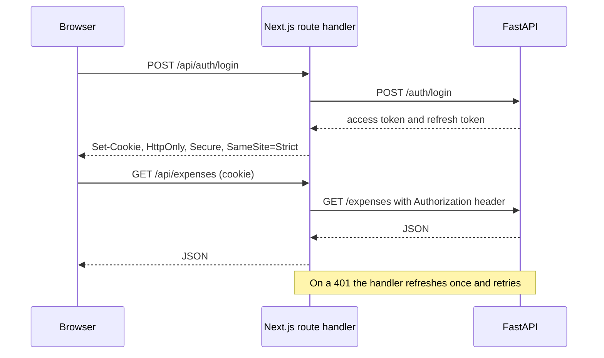
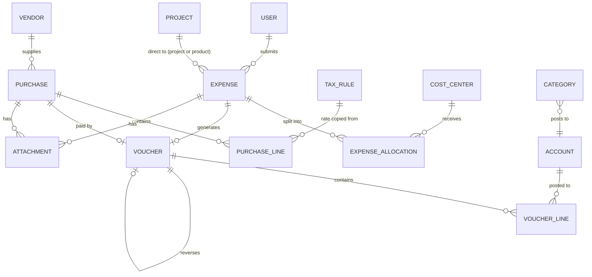
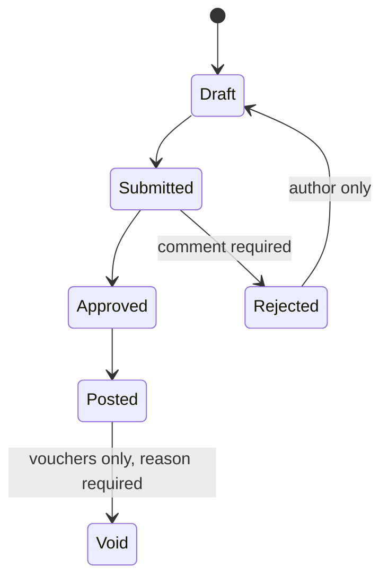
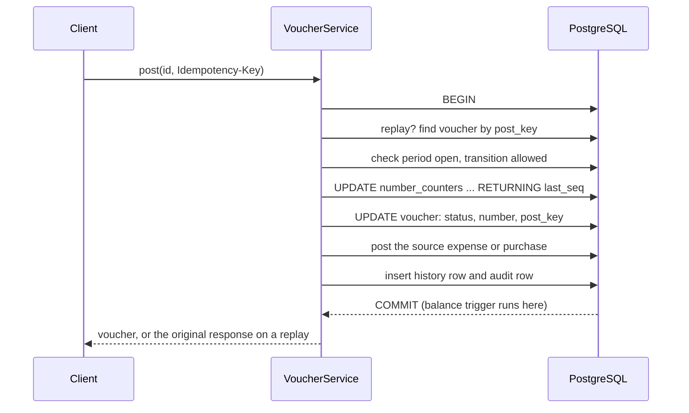

# Architecture

Small on purpose. **One API, one database, one web app, one mobile app.** No queue, no cache, no
microservices. If the database can enforce a rule, it does.

## 1. The whole system

**Folders:** `backend/`, `frontend/`, `mobile/`, plus `docs/`. Three apps, three folders, nothing shared
between them. Each client generates its own API types from `backend/openapi.json`.

## 2. Backend layers

Rules enforced by a test, not by hope:
- Routers never import models. Services never import FastAPI.
- A status never changes except through `core/transitions.py`.
- Errors are raised as a `DomainError` subclass with a code from one enum.
- Create, Update and Read schemas are separate. Unknown request fields are rejected.

**Patterns, each used because it earns its place:** state machine (one table for three document types),
repository, strategy (percentage and fixed allocation), factory (voucher built from an expense or purchase),
dependency injection (role guard, session, current user).
**Deliberately not used:** a generic base repository, interfaces with one implementation, CQRS, event sourcing.

## 3. Web security: the BFF pattern

The browser never holds a token it can read. Next.js route handlers sit between the browser and FastAPI.

- One catch-all proxy route plus login, logout and refresh routes. Nothing more.
- Cookie sessions need CSRF protection: `SameSite=Strict` plus an `Origin` check on every mutating route.
- Mobile skips the BFF. It calls FastAPI directly and keeps tokens in `expo-secure-store`.

## 4. Data model

`users` has one `role` and a nullable `tour_completed_at`.

Supporting tables: `number_counters`, `document_events` (approval history), `audit_events`, `auth_tokens`
(reset and invite), `refresh_tokens`, `closed_periods`, `posting_accounts`.

**Table rules**
- `document_date` (DATE, the accounting date, may be back-dated) is separate from `created_at` (`TIMESTAMPTZ`, UTC).
- Master data deactivates, never deletes (a trigger blocks deletes). Posted records are reversed, never edited.
- Tax rates and account mappings are resolved when saved and copied onto the row.
- A vendor's registration and filer flags are copied onto the purchase so a later vendor edit cannot change it.
- `projects` holds both projects and products (a `kind` column).
- One `document_events` table and one `document_status` enum serve expenses, purchases and vouchers.

## 5. What the database enforces

| Rule | Mechanism |
|---|---|
| Debits equal credits per voucher | **Deferred constraint trigger**, checked at commit |
| Each voucher line has exactly one side, positive | `CHECK ((debit > 0) <> (credit > 0))` |
| Voucher numbers are unique and posted means numbered; void means a reason | Unique constraints and `CHECK`s |
| At most one reversal per voucher; a reversal cannot be voided | Partial unique index and `CHECK` |
| A retried post or void creates one voucher | Unique indexes on `post_key` and `void_key` |
| Allocations sum to 10,000 basis points and to the expense amount | Deferred triggers on both sides |
| Direct expense has attribution, indirect has none | `CHECK` |
| Registered vendor has NTN and STRN; tax invoice has a number | `CHECK` |
| Tax rules never overlap in time | Exclusion constraint (`category` is `NOT NULL`, default `any`, because a nullable column never conflicts) |
| Master data cannot be deleted | Trigger |
| The audit log can only be appended to | Application role has insert and select only |

**Why the trigger is deferred:** voucher lines are inserted one at a time. A normal trigger fires after
line one, when debits cannot yet equal credits, and rejects every voucher.
**Why not a sequence for voucher numbers:** PostgreSQL does not roll sequences back, so a failed transaction
leaves a gap, and an auditor will ask why PV-2026-0007 is missing. A counter row incremented with
`UPDATE ... RETURNING` inside the posting transaction is rolled back with it.
**Known gap, accepted:** a voucher or indirect expense with no child rows passes the triggers. The service
refuses it at submit.

## 6. Status flows

One transition table drives expenses, purchases and vouchers. Each row names the roles allowed and the guards.

| Situation | Status | Code |
|---|---|---|
| Pair not in the table | 409 | `INVALID_TRANSITION` |
| Role not allowed, or approving your own document | 403 | `FORBIDDEN`, `SELF_APPROVAL_FORBIDDEN` |
| A guard failed (incomplete, unbalanced, comment missing, period closed) | 422 | the guard's name |
| Stale `version` | 409 | `VERSION_CONFLICT` |
| Another user's record, seen by Staff | 404 | `NOT_FOUND` |

## 7. Posting a voucher

The counter lock is held until commit, so posts for one type and year run one at a time. That is fine at this
scale. Stop a stuck transaction from blocking everyone with a `lock_timeout` and a `statement_timeout`.
After a lost race, re-read with `populate_existing` or the ORM returns a stale copy.

## 8. API conventions

- Base path `/api/v1`. Resources are nouns. State changes are `POST /{id}/<action>`, never `PATCH {status}`.
- The server recomputes totals, tax and status. Client amounts are not trusted.
- **Lists:** `limit` and `offset` with a total count, page size clamped to 100, response `{items, total, limit, offset}`,
  sort fields whitelisted (anything else is 422).
- **Concurrency:** `If-Match: <version>` on updates. `Idempotency-Key` required on post and void.
- **Errors:** RFC 7807 JSON with `code`, `correlation_id` and optional `errors[]` with field paths.
  Statuses: 400, 401, 403, 404, 405, 409, 413, 422, 429 (with `Retry-After`), 500 (correlation id only).
- **Time:** instants are ISO 8601 UTC with `Z`; business dates are `YYYY-MM-DD`; `GET /me` returns the display zone. The server stamps
  every instant. Details in `domain-rules.md` section 7.
- `/health`, `/ready` (database reachable) and `/version` (git SHA).
- OpenAPI is the only contract. Each client generates types from `backend/openapi.json`. CI fails if a
  committed copy is stale.

## 9. Security in one table

| Concern | Control |
|---|---|
| Passwords | argon2id. Identical response and timing for an unknown email. Admins trigger reset emails and never see or set a password |
| Sessions | Access token 15 minutes. Refresh token rotating and stored hashed. Reuse of a consumed refresh token revokes all of that user's refresh tokens |
| Brute force and abuse | Named rate-limit policies (section 9a), keyed on the email or user first and the IP second, held in memory, one API worker |
| Access | Role dependency on every route plus an ownership check in the service. Staff see only their own expenses. Nobody approves their own document |
| Data | Vendor bank account encrypted and masked in every response. Reset tokens hashed. No tokens, bank details or personal data in logs |
| Uploads | File signature check, size cap, EXIF removed, stored in Cloudinary as authenticated (non-public) assets, fetched only through an authenticated API endpoint after an ownership check |
| CSV | Cells starting `= + - @` are neutralised. UTF-8 with a byte-order mark |
| Transport | Strict CORS list, security headers, HTTPS redirect that does not break health probes |
| Config | The API refuses to start in production with `DEBUG` on or a weak `SECRET_KEY` |
| Bank change | Changing a vendor's bank account needs the password again, notifies the owner, and is audited |

## 9a. Rate limits

One small limiter in `core/rate_limit.py`: a sliding window held in memory, policies defined as data, an exceeded limit returns
429 `RATE_LIMITED` with `Retry-After`. Limits are throttles, not lockouts. Every number is a setting.

| Policy | Key | Default |
|---|---|---|
| Login failures, strict | Email and IP together | 5 per 15 minutes |
| Login failures, loose | Email alone | 30 per hour |
| Login failures | IP alone | 20 per 15 minutes |
| Forgot password | Email | 3 per hour |
| Forgot password | IP | 10 per hour |
| Reset confirm and invite accept | IP | 10 per 15 minutes |
| Admin-triggered reset or invite resend | Target user | 3 per hour |
| Receipt uploads | User | 30 per hour |
| CSV exports | User | 10 per hour |
| All authenticated routes | User | 300 per minute (a safety net) |

**Hardening, each one closing a real attack**
- **Count before the expensive work, atomically.** An attempt is counted before the password is checked and refunded on
  success, and the check-and-count is a single locked operation. Otherwise a burst of parallel requests all pass the check
  before the first failure is recorded.
- **Limit checks run before password hashing**, so rejected requests cost almost no CPU.
- **Key on exactly the value used for the account lookup** (trimmed, lower-cased, the same Unicode normalisation). Any
  difference lets an attacker vary the spelling to get a fresh counter. Unknown emails are counted the same as real ones.
- **Trust a client address only from the BFF, proven by a shared secret.** The BFF sends the browser's address in a dedicated
  header with a secret; the API uses it only when the secret matches (constant-time comparison), and otherwise uses the
  connection address seen by the host's proxy. A bare `X-Forwarded-For` is never trusted, because the API is public and anyone
  can send it. Without this, every web user shares the BFF's address and an attacker could use up that shared budget to block
  all web logins, or could spoof addresses to dodge the IP limits.
- **Bounded memory.** Expired entries are purged on a schedule; keys are capped in length (an email is at most 254 characters)
  and in number. When full, the entries with the fewest hits are dropped first, so a counter near its limit is never the one
  lost; an attacker cannot flush a victim's counter by flooding junk keys.
- **Targeted slow-down is limited, not eliminated.** An attacker can send failures for someone's email. Because the strict key
  includes the IP, failures from the attacker's address do not block the user's own address; only the loose per-email cap
  (30 per hour) can still slow them. That residual is accepted and visible in the logs.
- **Email protection:** forgot-password and resend limits stop one person flooding a mailbox or using up the provider's daily cap.

**Limits of this design:** the counters reset on restart and are not shared between processes, so run one API worker. A
restart is the main way to reset them, which is why the memory bound matters: it removes the easy way to crash the process.
A large distributed flood is a denial of service no in-process limiter stops; that needs protection in front of the host.
The upgrade path is in `decisions.md` row 22.

## 10. Errors

One enum of error codes, listed in the OpenAPI file. One handler turns every domain error into the JSON shape
above. An unhandled error returns a bare 500 with a correlation id and logs the trace. Every request is one
transaction, so a failure leaves nothing half-written.
The UI maps each code to its own wording and has a fallback for unknown codes, because web and mobile ship
separately. Each error says what happened and what to do. A failed form keeps what was typed. Custom 404, 403
(naming the role needed), 500 (with a copyable correlation id) and offline pages.

## 11. Testing

| Kind | Notes |
|---|---|
| Unit and property | Money, allocation (sums exactly, within one unit of ideal, stable under reordering, **winners outrank non-winners by remainder**), transitions, numbering, fiscal year |
| Constraint | Every rule in section 5, reached **by bypassing the service**. Call `SET CONSTRAINTS ALL IMMEDIATE`, because tests never commit and deferred triggers would not fire |
| Service and API | Rules, ownership, status codes, error codes |
| Access matrix | Every endpoint by every role. Marked `slow`, run at review steps |
| Race | Needs a committing test database. Parallel posts, parallel approvals, a replayed key. Repeat eight times |
| End to end | One spine: log in, submit, approve, generate, post, void |

Two test setups from the start: a fast one rolled back per test, and a committing one on a scratch database
for races. Required by the brief: voucher balancing and status transitions.

## 12. Local environment (Docker)

Everything runs through `docker compose`. Claude Code writes these files in Pass 1; this is the spec.

| Service | Purpose |
|---|---|
| `postgres` | PostgreSQL 16, published on **5433** so it does not clash with a PostgreSQL already installed on the host, healthcheck with a `start_period` |
| `backend` | FastAPI with reload, port 8000, depends on a healthy database |
| `frontend` | Next.js dev server, port 3000 |
| `mailpit` | Optional, `--profile mail`, catches email at port 8025 |
| `backend-test`, `frontend-test` | `--profile test`, one command each |

- A second database `daftar_test` is created by an init script, so tests never touch dev data.
- The Python virtualenv lives outside `/app` so a bind mount cannot hide it. `node_modules` and `.next` use
  anonymous volumes for the same reason. File watching on Windows needs polling.
- Receipts go to Cloudinary through one small storage interface. The Cloudinary credentials come from the `CLOUDINARY_URL` environment variable. Tests use an in-memory fake, so the suite needs no network.
- Mobile is not in Docker. Expo runs on the host and on a phone. On a phone, `localhost` is the phone, so the
  app needs the computer's LAN address.

## 12a. Receipts (Cloudinary)

- One storage interface (`save`, `fetch`, `remove`) with a Cloudinary implementation and an in-memory fake for tests.
- The backend receives the upload, checks the file signature and size, re-encodes images to remove EXIF and GPS,
  records a SHA-256, then uploads with delivery type **authenticated** so the asset has no public URL.
- Clients never talk to Cloudinary and never see its secret. They ask the API for a receipt; the API checks
  ownership, then returns the bytes (or a short-lived signed URL).
- `attachments` stores the Cloudinary `public_id`, content type, size, SHA-256, uploader and parent document.
- Read the current Cloudinary SDK documentation before writing the integration; do not rely on memory for
  function names.

## 12b. Mobile app (Expo, React Native)

- Expo with TypeScript and Expo Router. It runs on the host and on a phone through Expo Go; it is not in Docker.
- Types are generated from `backend/openapi.json`. Design tokens come from `frontend/design/tokens.json`.
  The error-code message map is copied from the web app. Same API, same wording, same rules.
- Scope from the brief: capture an expense with a receipt photo, view and approve items, view vouchers.
- Tokens in `expo-secure-store`, never AsyncStorage. Server state with TanStack Query.
- Captures go into a persisted queue (retry, visible status, failure reason, idempotency key) so a dropped
  connection never loses or duplicates one. An offline banner, and a minimum-version check so an old build
  cannot post against a changed API.
- On a phone `localhost` is the phone: point the app at the computer's LAN address and allow it through the
  firewall.
- Check current Expo SDK documentation for package and API names before use.

## 12c. Caching and background work

- **No server-side cache and no queue.** One API process and one database are ample for a company of 20 to 30 people (section 14).
- **Client cache:** TanStack Query holds reference data for a few minutes and invalidates it on mutation. Documents,
  balances and anything involving money always refetch after a mutation and on window focus.
- **Background work:** email runs as a FastAPI background task after the response, so a slow or failing provider never
  blocks or fails a request; failures are logged with the correlation id. Exports stream. Receipt upload to Cloudinary
  happens inside the request, because the result is needed.
- **Process-local state:** the login rate limiter lives in memory and resets on restart. This is a stated limit.
- **If the load grows:** add a worker and a queue for email and large exports, a shared store for rate limits, and a
  cache for report aggregates (after period balance checkpoints).

## 12d. Public screens and onboarding

- **Public surface:** login, forgot password, reset password and accept invite. All four use one 50/50 split layout, a
  brand panel and the form; below the tablet breakpoint the panel collapses to a compact header. Everything else needs a
  session. `robots.txt` disallows everything and every route sends `noindex`.
- **Invites and resets:** one `auth_tokens` table (purpose, hashed token, expiry, used-at). An invite is created by an Admin
  with a role and an email; accepting it creates the account. A reset is requested by the user or triggered by an Admin;
  both send the same email. Email is sent after commit as a background task: Mailpit locally, Resend when deployed.
- **Onboarding tour:** `users.tour_completed_at` (null means show the tour). `GET /me` returns it; `POST /me/tour` records
  completion or a skip. The tour is role-aware, 4 to 6 steps, skippable at every step, and can be relaunched from the
  profile menu. Mobile shows a three-card intro driven by the same flag.

## 13. Deployment (free tiers; confirm current limits before relying on them)

| Layer | Choice | Watch out for |
|---|---|---|
| Database | Neon | Use the pooled connection string. Suspends after about five minutes idle |
| Receipts | Cloudinary | One account for dev and production, separate folders; credentials in the host's environment settings |
| Email | Resend | Needs a verified domain, low daily cap |
| API | Render, from the backend Dockerfile | Sleeps when idle. Migrations are a release step, never at boot |
| Web | Vercel | Hobby tier is non-commercial |
| Mobile demo | Expo Go | No build needed |

Do not use Render's free Postgres: it is deleted after 30 days.

## 14. Capacity

Sized for a single company of 20 to 30 people: a few thousand documents a year at most. One small PostgreSQL and one
API process are ample. Ordinary good practice covers it: every list is paginated, filter and sort columns are indexed,
and no list endpoint has an N+1 query (a query-count test).

If it ever grew, in this order: period balance checkpoints and a cache for report aggregates, a worker and queue for
email and large exports, a shared rate-limit store, receipts served from Cloudinary with signed delivery URLs, a read
replica for reports, and partitioning of voucher lines and the audit table. Not built, and not needed: Kafka,
microservices, CQRS, Kubernetes.
