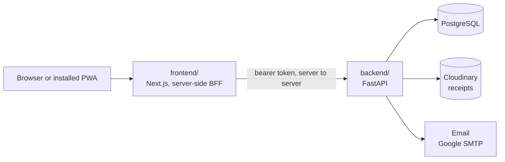
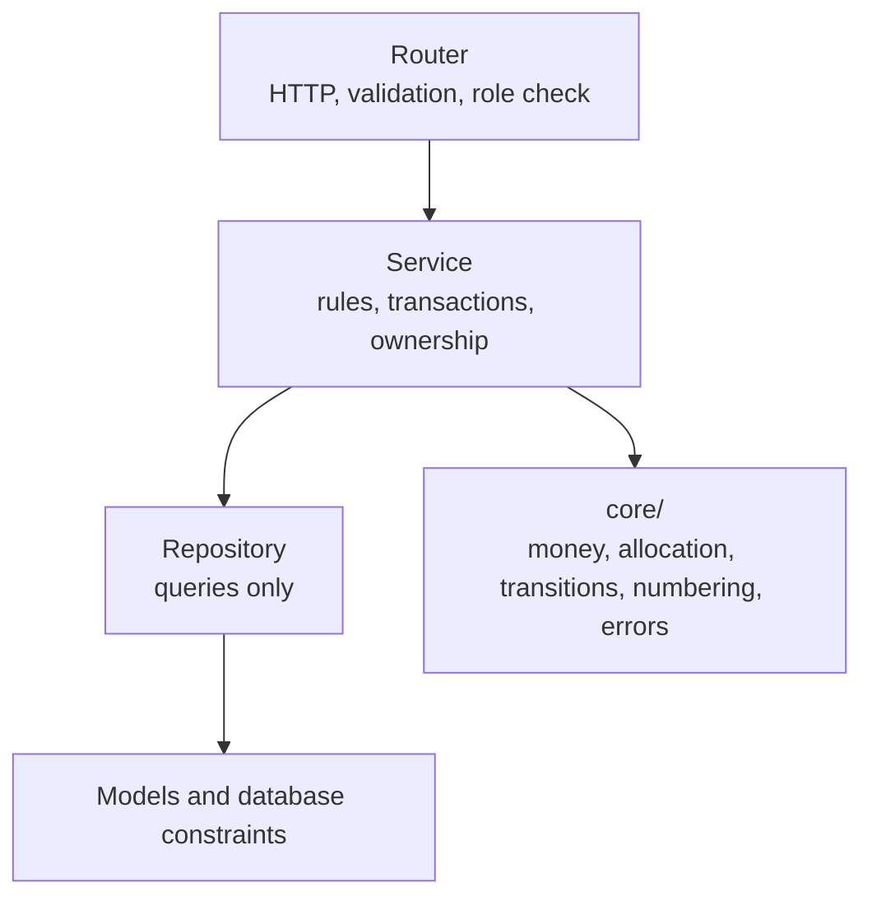

# Architecture

Small on purpose: **one API, one database, one web app that also installs as a phone app (PWA).** No queue, no cache, no
microservices. If the database can enforce a rule, it does.

Two folders, `backend/` and `frontend/`, plus `docs/`. The web app generates its types from `backend/openapi.json`.
Diagrams of the flows are in `process-flow.md`, the tables in `erd.md`, the security controls in `security.md`.

## Backend

Enforced by tests (`tests/test_architecture.py`):
- Routers never import models; services never import FastAPI.
- A status changes only through `core/transitions.py`: one table for expenses, purchases and vouchers.
- Errors are a `DomainError` with a code from one enum. Create, Update and Read schemas are separate; unknown fields are rejected.
- Money is `Decimal` and `NUMERIC(14,2)`; division happens only in `core/money.py` and `core/allocation.py`; no floats.

## Web app

- **Next.js 16**, CSS variables from three-tier design tokens (`frontend/design/tokens.json`), TanStack Query, no CSS framework.
- **BFF:** the browser never holds a token. Route handlers keep the access and refresh tokens in HttpOnly, SameSite=Strict
  cookies, proxy every call to the API, refresh once on a 401, and check `Origin` on every write. The API trusts the browser's
  address only when the BFF proves itself with a shared secret.
- **Role access:** the sidebar shows only what a role may open, and the layout redirects any other address to the home screen
  before anything is drawn. The API refuses the same calls; that is the real boundary.
- **PWA:** a manifest, generated icons and a camera button that opens the phone's camera and starts an expense with the photo.
  No service worker, so no offline mode (decision 148).

## What the database enforces

| Rule | Mechanism |
|---|---|
| Debits equal credits per voucher | Deferred constraint trigger, checked at commit |
| A voucher line has one side, positive | `CHECK ((debit > 0) <> (credit > 0))` |
| Numbers unique; posted means numbered; void means a reason | Unique constraints and `CHECK`s |
| At most one reversal per voucher; a reversal cannot be voided | Partial unique index and `CHECK` |
| A retried post or void creates one voucher | Unique indexes on `post_key` and `void_key` |
| Allocations sum to 100% and to the expense amount | Deferred triggers |
| Registered vendor has NTN and STRN; tax invoice has a number | `CHECK` |
| Tax rules never overlap in time | Exclusion constraint |
| Posted documents are frozen; master data cannot be deleted | Triggers |
| The audit log is append-only | The app role has insert and select only |

**Why the balance trigger is deferred:** lines are inserted one at a time, so a normal trigger would fire after line one and
reject every voucher. **Why not a sequence for numbers:** a rolled-back transaction leaves a gap in a sequence, and an auditor
asks why PV-2026-0007 is missing; a counter row updated inside the posting transaction rolls back with it.

## API conventions

- `/api/v1`, nouns for resources, `POST /{id}/<action>` for state changes. The server recomputes totals, tax and status.
- Lists take `limit` and `offset`, return `{items, total, limit, offset}`, clamp the page size to 100 and whitelist sort fields.
- `If-Match: <version>` on updates; `Idempotency-Key` required on post and void.
- Errors are RFC 7807 JSON with a `code`, a `correlation_id` and optional per-field messages.
- Instants are ISO 8601 UTC; business dates are `YYYY-MM-DD`; the screen shows the zone from `GET /me`.
- `/health`, `/version` (git SHA). The OpenAPI file is committed and a test fails if it is stale.

## Tests

| Kind | Covers |
|---|---|
| Unit | Money, allocation, tax, transitions (every pair and role), numbering, CSV, config, mail |
| Database | Every rule above, reached by bypassing the service (`SET CONSTRAINTS ALL IMMEDIATE`) |
| API | Every route by every role, ownership, error codes, exports, draft visibility, audit coverage |
| Parallel | Real concurrent posts, voids and approvals on a committing database |

Run with `docker compose --profile test run --rm backend-test` (lint, format, types, then about 960 tests). Tests use their own
database and a fake receipt store.

## Running and deploying

Locally everything runs in `docker compose` (Postgres on 5433, API on 8001, web on 3001). Deployed: Neon (database, direct
connection), Render (API from `backend/Dockerfile`, migrations run by hand, one worker), Vercel (web, root `frontend`),
Cloudinary (receipts, authenticated assets served only through the API) and Google SMTP (email, sent after commit). Steps and
every variable are in `deploy.md`.

## Limits, stated

- One API process: the rate limiter is in memory and resets on restart.
- Sized for 20 to 30 users and a few thousand documents a year. If it grew: report caches, a worker for email and exports, a
  shared rate-limit store.
- No virus scanning of uploads (images are re-encoded, which removes anything but pixels).
- No offline mode and no native app (decision 148).
