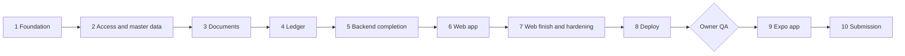

# Build plan

Ten passes, in order. Tick each box as the step is done, so the file always shows where the build stands.
A pass ends with a checkpoint: the checks pass, a short report is written, and the owner reviews.

Rules for every pass:
- Backend before frontend; the web app before mobile. Mobile converts the finished web app.
- Lint, format and types run before the tests. The full suite runs after any migration.
- Every user story gets a test or a check named with its ID (`test_e3_...`); tick `story-matrix.md`.
- A database rule gets a test that reaches it by bypassing the service (use `SET CONSTRAINTS ALL IMMEDIATE`).
- A locking or idempotency feature gets a real parallel test.
- On review steps, break the rule once, show the tests fail, restore it.
- Stop conditions: a sensitive command (see `workflow.md`), a gate failing twice, a missing credential, an
  ambiguity in the brief. Otherwise keep going.

---

## Pass 1: Foundation
Model: strong · Review: money and allocation, status rules

**Repository and Docker**
- [ ] `backend/`, `frontend/`, `mobile/` (empty), `docker-compose.yml`, two Dockerfiles, `.env.example`, `.gitignore`, `.gitattributes`
- [x] Compose services: `postgres` (16, published on 5433, healthcheck with `start_period`), `backend` (reload, port 8000), `frontend` (port 3000), `mailpit` (profile `mail`), `backend-test` and `frontend-test` (profile `test`)
- [x] An init script creates `daftar_test` so tests never touch dev data
- [x] Python virtualenv outside `/app`; anonymous volumes for `node_modules` and `.next`; file-watch polling; pnpm pinned through `packageManager`; `uv.lock` and `pnpm-lock.yaml` committed
- [x] Flat backend layout (`app/`), `pythonpath = ["."]` in the pytest config; TypeScript pinned to 5.x while lint tooling lags

**Backend base**
- [x] `uv`, ruff, mypy strict, pytest, hypothesis
- [x] Time: containers and database session in UTC; `DISPLAY_TIMEZONE` setting (default `Asia/Karachi`); timezone-aware datetimes only, naive ones rejected; instants sent as ISO 8601 UTC with `Z`; business dates as `YYYY-MM-DD`; `GET /me` returns the display zone; the server stamps every instant
- [x] Settings that refuse to start in production with `DEBUG` on or a weak `SECRET_KEY`
- [x] Error code enum, one handler returning RFC 7807 JSON, bare 500 with a correlation id; defined code for 405 and other 4xx
- [x] Correlation-id middleware on every request and log line; no tokens or personal data in logs
- [x] `/health`, `/ready` (database reachable), `/version` (git SHA)

**Database and test setup**
- [x] Alembic, session dependency with a bounded pool, `statement_timeout`, `lock_timeout`
- [x] Users table; shared `document_status` enum
- [x] Two test setups: fast (rolled back per test) and committing (scratch database, for races)
- [ ] Fixtures: clock, password-hash cache, `SET CONSTRAINTS ALL IMMEDIATE` helper, route inventory from the OpenAPI file; markers `slow` and `concurrency`
- [x] A test that fails if a router imports a model or a service imports FastAPI

**Core**
- [x] `core/money.py` and `core/allocation.py` per `domain-rules.md` sections 1 and 2, with the property tests. REVIEW: reverse the remainder order once and show the tests fail
- [x] `core/transitions.py`: one table (entity, from, to, roles, guards) and a matrix test over every pair for all three entities. Failure codes per `architecture.md` section 6
- [x] Audit: `audit_events` table (insert and select only for the app role) and a service that writes inside the caller's transaction

**Checkpoint**
- [x] `docker compose up -d --build`; backend healthy, frontend up, `localhost:8000/docs` and `localhost:3000` respond (owner's ports: 8001 and 3001, decision 72)
- [ ] Backend and frontend tests pass in their containers; lint and types clean (backend: 162 tests pass; frontend: lint and types pass, no test runner yet, deferred to the end by the owner's call)
- [x] Migrations apply to an empty database and re-run cleanly (proved on a scratch database by `tests/db/test_migrations.py`; the dev database is migrated once at the end, by the owner's call)

---

## Pass 2: Access and master data
Model: strong for auth, cheap for the rest

- [x] Login, refresh, logout: argon2id; access token 15 minutes; rotating refresh token stored hashed; reuse revokes all of that user's refresh tokens
- [x] Generic login error with identical timing for an unknown email
- [x] Rate limiter in `core/rate_limit.py` per `architecture.md` section 9a: sliding window in memory, policies as data, `429` with `Retry-After`; an atomic count-before-check that is refunded on success; keys normalised exactly like the account lookup; bounded memory that drops the entries with the fewest hits first; applied to login, forgot password, reset confirm, invite accept, Admin-triggered resets and resends, and as a per-user safety net on authenticated routes
- [x] Role dependency on routes plus ownership checks in services; the access-matrix test (every endpoint by every role, marked `slow`) grows with each endpoint
- [x] Users: an Admin invites by email with one role; email is unique; invite tokens are hashed, single use, expire in 7 days; the invitee sets name and password; an Admin can resend or revoke a pending invite
- [x] Password reset, self-service and Admin-triggered: both send the same single-use 30-minute token; the reply never reveals whether an email exists; an Admin never sees or sets a password; using a link, changing a role or deactivating a user revokes that user's refresh tokens; email goes to the console until Pass 5
- [x] Role rules: only Admins invite, change roles, deactivate or trigger resets; a user cannot change their own role or deactivate themselves; the last active Admin cannot be demoted or deactivated; roles are read from the database on every request; users deactivate, never delete; all of it audited
- [x] Vendors first and carefully: NTN and STRN required when registered (database `CHECK`), a separate filer flag, bank account encrypted and masked, a bank change needs the password again, notifies the owner and is audited
- [x] Then accounts (tree, parents not postable), categories, cost centres, projects and products (one table, a `kind` column), periods, posting accounts. Deactivate, never delete (trigger); inactive records still render on old documents
- [x] Lists use `limit` and `offset` with a total count, clamp page size to 100, whitelist sort fields; unknown request fields are rejected
- [x] Tax rules per `domain-rules.md` section 5: exclusion constraint, lookup by document date preferring a specific category over `any`, seeded rates with cited sources
- [x] Rate-limit tests with the clock fixture: each policy returns 429 at its limit with `Retry-After`; the window slides; unknown emails are counted like real ones and the reply is identical; a burst of parallel logins cannot exceed the limit; spelling variants of an email share one counter; a client-address header without the BFF secret is ignored; filling the table with junk keys does not drop a counter that is near its limit; failures from another IP do not block the user's own IP (the upload and export policies have no endpoint yet; they are tested with the endpoints in Passes 3 and 5)
- [x] **Checkpoint:** stories A1 to A4, B1 to B5, I1, I4, I7 and I8 have named tests; the access matrix and the rate-limit tests pass

---

## Pass 3: Documents
Model: strong for the workflow engine and purchases

- [x] Expenses: direct or indirect per the `CHECK`s; allocations use the Pass 1 function; deferred triggers check sums on both sides; the preview endpoint; changing the amount recomputes percentage allocations
- [x] A reusable workflow engine built on `core/transitions.py`: submit, approve, reject (comment required), reopen (author only), history in one `document_events` table, `version` and `If-Match`, visibility rules. Expenses, purchases and vouchers all use it
- [x] Attachments on expenses and purchases (Cloudinary), with a per-user upload limit: storage interface with a Cloudinary implementation and an in-memory fake; file signature check, size cap, EXIF removal, SHA-256; authenticated upload; download only through the API after an ownership check. Read the current Cloudinary SDK docs first (verified with the in-memory store; the live Cloudinary check waits for `CLOUDINARY_URL`)
- [x] Purchases: lines with item, quantity, rate, tax; totals recomputed on the server; both withholdings; memo versus invoice; rate and rule id copied onto each line; negative payable refused; every vendor combination gives a different rate in the test data
- [x] Parallel test: two simultaneous approvals give one winner and one 409
- [x] REVIEW: reach the allocation trigger by bypassing the service; show it rejects at commit
- [x] **Checkpoint:** stories C1 to C5, C7, D1 to D4, F2 have named tests (C6 is Pass 4)

---

## Pass 4: Ledger
Model: strong · Plan mode · Review: everything in this pass

- [x] Voucher and line tables; each line has exactly one side; optional cost centre and project per line
- [x] Deferred constraint trigger for debit equals credit; a balance-check endpoint returns the totals, the difference and the offsetting line. REVIEW: disable the deferral once and show the test fail
- [x] Counter-row numbering at Post; `Idempotency-Key` with unique `post_key`; period lock; close and reopen periods, audited; after a lost race re-read with `populate_existing`
- [x] Parallel tests: N simultaneous posts give N consecutive numbers; a replayed key gives one voucher. Repeat eight times
- [x] Void with a reason and its own `void_key`; reversing voucher in the same transaction; one reversal per voucher; a reversal cannot be voided; parallel test for void
- [x] Generation from an approved expense or purchase through the category-to-account mapping; separate tax lines; generating twice blocked; posting posts the source; a fresh install can generate a voucher
- [x] Lines of submitted and approved vouchers frozen
- [x] Explain, in the pass report, why the trigger is deferred and why a sequence cannot number vouchers
- [x] **Checkpoint:** stories E1 to E6, D5, C6 have named tests; the parallel tests pass eight times in a row

---

## Pass 5: Backend completion
Model: cheap

- [x] Email after commit, as background tasks, for submit, approve, reject, invite and reset; console, Mailpit or Resend by setting; a provider failure is logged and never fails the request (test it)
- [x] Per-user export limit on CSV downloads
- [x] Reports: expenses by type and cost centre, purchases by vendor split registered or not, voucher register; CSV per `domain-rules.md` section 9
- [x] Duplicate warnings per `domain-rules.md` section 8
- [x] A query-count test on list endpoints
- [x] An audit-coverage test: list every mutating route and prove each writes an audit row in its own transaction
- [x] CI workflow (`.github/workflows/ci.yml`): lint, types and the full backend suite against a Postgres service, then frontend lint, types, tests and build
- [x] `backend/openapi.json` exported and committed; the API list for the docs generated from it
- [x] Seed data per `seed-data.md`
- [x] **Backend check:** every backend story in `story-matrix.md` is ticked with evidence; lint, types and the full suite pass; the whole flow (create, submit, approve, generate, post, void) works through `localhost:8000/docs`

---

## Pass 6: Web app
Model: strong for design and BFF, cheap for repeated screens · Apply the `daftar-ui` skill

- [ ] Design plan first (colours with hex values, typefaces and roles, one layout idea, what makes it distinct), critiqued and revised, recorded in `decisions.md`. **Design checkpoint:** show the plan and one finished screen in both themes before building the rest
- [ ] Public screens (login, forgot password, reset password, accept invite) in one 50/50 split layout: brand panel and form, the panel collapsing to a compact header on narrow screens; no stock illustration; a demo-accounts helper under the form only when `DEMO_MODE` is on
- [ ] Onboarding tour: 4 to 6 role-aware steps, Skip always visible, Escape closes it, completion saved on the server (`users.tour_completed_at`), relaunch from the profile menu. Use a small tour library for spotlight and positioning rather than hand-rolling it; confirm current React 19 compatibility and keyboard and screen-reader behaviour first
- [ ] One date module for the web app: formats with the zone from `/me`, never the browser's; one date format and one instant format (`domain-rules.md` section 7); server-rendered and client-rendered output identical. Tests run under several `TZ` values (UTC, Asia/Karachi, America/Los_Angeles) and must give identical output
- [ ] Tokens in three tiers; theme System, Light, Dark, set before first paint; saved as `frontend/design/tokens.json`
- [ ] TanStack Query cache policy: reference data cached for minutes and invalidated on mutation; documents, balances and money always refetch after a mutation and on focus
- [ ] `RATE_LIMITED` shows the wait time from `Retry-After` on web and mobile
- [ ] BFF sends the browser's address in a dedicated header with a shared secret (`BFF_SHARED_SECRET`, generated by the owner and set on both hosts)
- [ ] BFF: login, logout, refresh and a catch-all proxy; HttpOnly cookies; `Origin` check on mutating routes; error-code to message map with an unknown-code fallback
- [ ] App shell: role-filtered sidebar, top bar, profile menu with theme and density
- [ ] `docs/ui-flow.md`: the screen map and navigation per role, kept current as screens are built
- [ ] Role-aware home; master-data screens (the table pattern set once: sticky header, filter chips with clear-all, sort direction, filters in the URL)
- [ ] Expenses with the allocation editor (live remainder, exact per-centre preview); receipt upload with progress
- [ ] Purchases with the line grid and tax breakdown; memo flag; duplicate banner
- [ ] **Voucher editor:** spreadsheet-like lines, persistent balance strip, one-click balancing line, Submit that explains why it is disabled; post, void with reason, generate from source; never optimistic; print stylesheet
- [ ] Approvals queue, reports with CSV download, audit screen
- [ ] **Checkpoint:** the voucher flow works with the keyboard only; no token is readable in `document.cookie`, storage or any bundle

---

## Pass 7: Web finish and hardening
Model: strong for the security review

- [ ] Responsive at 360, 768, 1024 and 1440 px on every screen, in light and dark, including dialogs, dropdowns, toasts and print
- [ ] Pending state, disabled button and toast with retry on every mutation; empty, loading and error states everywhere; error boundary per route; 404, 403 (names the role needed), 500 (copyable correlation id), 503 and offline pages
- [ ] Accessibility: labels, focus ring, contrast in both themes, keyboard use, an automated scan
- [ ] The tour is keyboard accessible, skippable at every step, and correct at 360 px in both themes
- [ ] Session expiry mid-form keeps the draft and the intended URL
- [ ] Time checks: a document submitted at 00:30 and at 23:30 in the display zone shows the right day on web; CSV dates and instants follow `domain-rules.md` section 7
- [ ] One end-to-end test: log in, submit, approve, generate, post, void
- [ ] Public surface: only the Pass 6 login screens; `robots.txt` disallows everything and every route sends `noindex`; the footer shows the version and git SHA. No landing, SEO or legal pages (reasons in `decisions.md` section 5b)
- [ ] Security review over the whole repo in a fresh context (`/review`), findings fixed or recorded in `docs/security.md`; dependency audit; secrets absent from history; headers and CORS list
- [ ] Confirm every list paginates, filter and sort columns are indexed, and no N+1 remains (the query-count test passes)
- [ ] **Frontend check:** every story with a screen is ticked; all four roles walked; lint, types, tests and build pass in Docker; the end-to-end test is green

---

## Pass 8: Deploy
Model: cheap · Needs the owner's accounts and secrets

- [ ] Prepare deployment config and a step list: Neon (pooled connection string), Render from the backend Dockerfile (migrations as a release step, never at boot), Vercel for the web app, Cloudinary production credentials, Resend with a verified domain
- [ ] The owner enters secrets in each dashboard. Claude never reads or writes `.env`
- [ ] Production config confirmed: `DEBUG` off, strong key, CORS locked to the real origin
- [ ] Migrate and seed the live database
- [ ] **Checkpoint:** `/version` on the live URL matches the commit; a stranger can log in from a private window

**Owner QA (after Pass 8):** walk every screen as each role in both themes at 360 and 1440 px; try to break the voucher
editor (unbalanced, both sides on a line, a parent account, a negative amount); as Staff try to approve and to open
another user's record by id; double-click Post; void one and check the reversal and audit rows; allocate three ways and
check where the extra paisa lands; export every report into Excel including a vendor named `=cmd`.

---

## Pass 9: Expo app (conversion of the finished web app)
Model: strong for the offline queue, cheap for the rest · Apply the `daftar-ui` skill

- [ ] Expo (TypeScript, Expo Router); types generated from `backend/openapi.json`; tokens from `frontend/design/tokens.json`; the error-code message map copied from the web app
- [ ] Login with tokens in `expo-secure-store`, cleared on logout; the API address is configurable and defaults to the computer's LAN address
- [ ] **Capture:** camera first, image compressed, form prefilled with today and the user's default cost centre, upload to the same endpoint as web
- [ ] **Offline queue:** persisted, retried, visible, failure reason per item, idempotency key prevents duplicates; offline banner; minimum-version check
- [ ] My items; approvals queue with approve and reject plus comment under the same server rules; vouchers read-only
- [ ] A three-card intro on first launch, skippable, using the same server-side completion flag as the web tour
- [ ] 44 px tap targets, pull to refresh, light and dark
- [ ] The same date rules as the web app (fixed display zone from `/me`, same formats); confirm the chosen date library formats a fixed zone correctly on the Hermes engine, and that output matches web for a set of fixed instants
- [ ] Unit tests for the queue, the error map and the date formatting under several device timezones
- [ ] **Checkpoint:** runs on a real phone through Expo Go against the running API; a capture taken in airplane mode uploads exactly once when the connection returns

---

## Pass 10: Submission
Model: cheap

- [ ] `docs/` complete: `spec.md`, `erd.md` (from the real models), `process-flow.md` (status flows, approval and posting sequences), `ui-flow.md`, `api.md` (from `openapi.json`), plus architecture, decisions, domain rules, build plan, security
- [ ] README: 60-second quickstart, credentials table, both themes side by side, mobile run steps
- [ ] `PROMPTS.md` complete with model and effort per prompt; cost noted per pass; transcripts copied into `docs/transcripts/` with a short README
- [ ] Transcripts scrubbed before committing: search every file for keys, secrets, passwords and local paths; add a readable index (or a Markdown conversion) that maps each file to its pass
- [ ] `docs/MISTAKES.md`: what the AI got wrong and how it was caught
- [ ] The owner adds a remote and pushes; the two required test files (voucher balancing, status transitions) pass in CI
- [ ] A five-minute recording that follows the end-to-end test and ends on the tests passing
- [ ] Live URL plus local run steps verified on a clean machine
- [ ] Final walk of the anti-slop list in the `daftar-ui` skill
