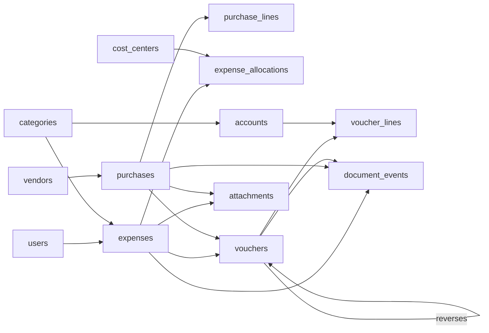

# Data model

Every table, generated from the SQLAlchemy models (`backend/app/models/`), so it matches the code. `PK` is the primary key, `FK` a
foreign key, `UK` a unique column. The rules the database itself enforces are listed in `architecture.md` and tested in
`backend/tests/db/`.

## The shape, in one picture

A voucher is generated from one expense or one purchase (never both) and is reversed by at most one other voucher.
`document_events` is the approval history for all three document types.

## Notes

- Money is `NUMERIC(14,2)`; percentages are integer basis points (10,000 is 100%).
- `document_date` is the accounting date (a plain date); `created_at` and the other instants are UTC.
- Nothing is deleted: master data is deactivated and posted vouchers are reversed. `audit_events` accepts inserts only.
- A vendor's registered and filer flags are copied onto each purchase, and tax rates onto each purchase line.

## Every table

```mermaid
erDiagram
    accounting_settings {
        smallint id PK
        smallint fiscal_year_start_month
        bigint updated_by FK
        datetime updated_at
    }
    accounts {
        bigint id PK
        text code UK
        text name
        text type
        bigint parent_id FK
        bool is_postable
        bool is_active
        int version
        datetime created_at
        datetime updated_at
    }
    attachments {
        bigint id PK
        bigint expense_id FK
        bigint purchase_id FK
        text storage_key UK
        text content_type
        bigint size_bytes
        text sha256
        text original_name
        bigint uploaded_by FK
        datetime created_at
        datetime removed_at
        bigint removed_by FK
    }
    audit_events {
        bigint id PK
        datetime occurred_at
        bigint actor_id FK
        text action
        text entity_type
        bigint entity_id
        jsonb before
        jsonb after
        text correlation_id
    }
    auth_tokens {
        bigint id PK
        text purpose
        text token_hash UK
        text email
        text role
        bigint user_id FK
        bigint created_by FK
        datetime created_at
        datetime expires_at
        datetime used_at
        datetime revoked_at
    }
    categories {
        bigint id PK
        text name
        bigint account_id FK
        bool is_active
        int version
        datetime created_at
        datetime updated_at
    }
    closed_periods {
        bigint id PK
        date start_date
        date end_date
        bigint closed_by FK
        datetime closed_at
        bigint reopened_by FK
        datetime reopened_at
    }
    cost_centers {
        bigint id PK
        text code UK
        text name
        bool is_active
        int version
        datetime created_at
        datetime updated_at
    }
    document_events {
        bigint id PK
        text document_type
        bigint document_id
        text action
        text from_status
        text to_status
        bigint actor_id FK
        text comment
        datetime created_at
    }
    expense_allocations {
        bigint id PK
        bigint expense_id FK
        bigint cost_center_id FK
        smallint basis_points
        numeric amount
    }
    expenses {
        bigint id PK
        text expense_type
        text status
        bigint created_by FK
        date document_date
        bigint category_id FK
        numeric amount
        numeric tax_amount
        text currency
        text payment_method
        text description
        bigint project_id FK
        bigint cost_center_id FK
        text allocation_method
        int version
        datetime created_at
        datetime updated_at
    }
    number_counters {
        text voucher_type PK
        smallint year PK
        int last_seq
    }
    posting_accounts {
        text key PK
        bigint account_id FK
        bigint updated_by FK
        datetime updated_at
    }
    projects {
        bigint id PK
        text code UK
        text name
        text kind
        bool is_active
        int version
        datetime created_at
        datetime updated_at
    }
    purchase_lines {
        bigint id PK
        bigint purchase_id FK
        smallint line_no
        text item
        text category
        numeric quantity
        numeric rate
        smallint sales_tax_bp
        numeric subtotal
        numeric sales_tax
        numeric gross
        bigint sales_withholding_rule_id FK
        smallint sales_withholding_bp
        numeric sales_tax_withheld
        bigint income_withholding_rule_id FK
        smallint income_withholding_bp
        numeric income_tax_withheld
        numeric payable
    }
    purchases {
        bigint id PK
        text status
        bigint vendor_id FK
        bigint created_by FK
        date document_date
        text document_kind
        text invoice_number
        text description
        bool vendor_registered
        bool vendor_filer
        text currency
        numeric subtotal
        numeric sales_tax_total
        numeric gross_total
        numeric sales_tax_withheld
        numeric income_tax_withheld
        numeric payable
        int version
        datetime created_at
        datetime updated_at
    }
    refresh_tokens {
        bigint id PK
        bigint user_id FK
        text token_hash UK
        datetime created_at
        datetime expires_at
        datetime consumed_at
        datetime revoked_at
    }
    tax_rules {
        bigint id PK
        text tax_type
        bool supplier_registered
        bool supplier_filer
        text category
        smallint rate_bp
        date effective_from
        date effective_to
        text source
        bigint created_by FK
        int version
        datetime created_at
        datetime updated_at
    }
    users {
        bigint id PK
        text email UK
        text full_name
        text password_hash
        text role
        bool is_active
        datetime tour_completed_at
        datetime created_at
        datetime updated_at
    }
    vendors {
        bigint id PK
        text name
        bool is_sales_tax_registered
        bool is_filer
        text ntn
        text strn
        text contact_name
        text phone
        text email
        text address
        text bank_name
        text bank_account_encrypted
        text bank_account_last4
        bool is_active
        bigint created_by FK
        int version
        datetime created_at
        datetime updated_at
    }
    voucher_lines {
        bigint id PK
        bigint voucher_id FK
        smallint line_no
        bigint account_id FK
        numeric debit
        numeric credit
        text description
        bigint cost_center_id FK
        bigint project_id FK
    }
    vouchers {
        bigint id PK
        text voucher_type
        text status
        bigint created_by FK
        date document_date
        text description
        text number
        smallint year
        int seq
        bigint expense_id FK
        bigint purchase_id FK
        bigint reversal_of_id FK
        text post_key
        text void_key
        text void_reason
        datetime voided_at
        bigint voided_by FK
        int version
        datetime created_at
        datetime updated_at
    }
    accounts ||--o{ categories : "account_id"
    accounts ||--o{ posting_accounts : "account_id"
    accounts ||--o{ voucher_lines : "account_id"
    categories ||--o{ expenses : "category_id"
    cost_centers ||--o{ expense_allocations : "cost_center_id"
    cost_centers |o--o{ expenses : "cost_center_id"
    cost_centers |o--o{ voucher_lines : "cost_center_id"
    expenses |o--o{ attachments : "expense_id"
    expenses ||--o{ expense_allocations : "expense_id"
    expenses |o--o{ vouchers : "expense_id"
    projects |o--o{ expenses : "project_id"
    projects |o--o{ voucher_lines : "project_id"
    purchases |o--o{ attachments : "purchase_id"
    purchases ||--o{ purchase_lines : "purchase_id"
    purchases |o--o{ vouchers : "purchase_id"
    tax_rules ||--o{ purchase_lines : "income_withholding_rule_id"
    tax_rules ||--o{ purchase_lines : "sales_withholding_rule_id"
    users |o--o{ accounting_settings : "updated_by"
    users |o--o{ attachments : "removed_by"
    users ||--o{ attachments : "uploaded_by"
    users |o--o{ audit_events : "actor_id"
    users |o--o{ auth_tokens : "created_by"
    users |o--o{ auth_tokens : "user_id"
    users ||--o{ closed_periods : "closed_by"
    users |o--o{ closed_periods : "reopened_by"
    users ||--o{ document_events : "actor_id"
    users ||--o{ expenses : "created_by"
    users |o--o{ posting_accounts : "updated_by"
    users ||--o{ purchases : "created_by"
    users ||--o{ refresh_tokens : "user_id"
    users |o--o{ tax_rules : "created_by"
    users ||--o{ vendors : "created_by"
    users ||--o{ vouchers : "created_by"
    users |o--o{ vouchers : "voided_by"
    vendors ||--o{ purchases : "vendor_id"
    vouchers ||--o{ voucher_lines : "voucher_id"
```

