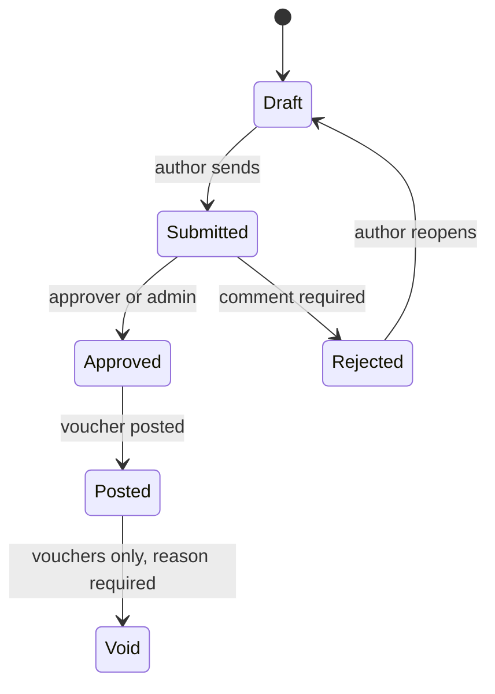
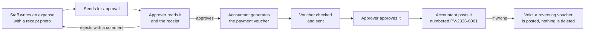
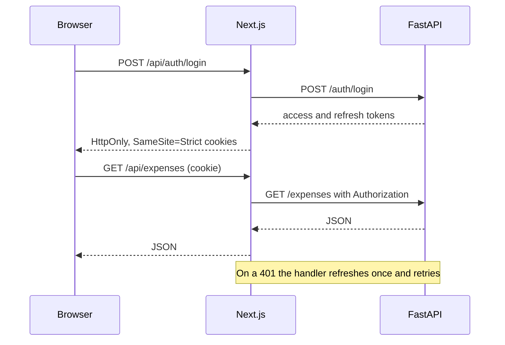
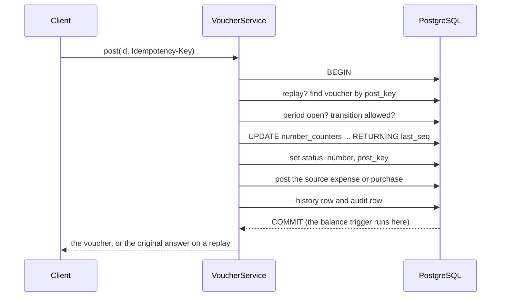

# Process flow

How a document moves, and the sequences behind the important actions.

## Status flow

One transition table (`core/transitions.py`) drives expenses, purchases and vouchers. Each row names the roles allowed and the
guards. Nobody approves a document they wrote.

| Situation | Status | Code |
|---|---|---|
| Pair not in the table | 409 | `INVALID_TRANSITION` |
| Role not allowed, or approving your own document | 403 | `FORBIDDEN`, `SELF_APPROVAL_FORBIDDEN` |
| A guard failed (incomplete, unbalanced, comment missing) | 422 | the guard's name |
| Accounting period closed | 409 | `PERIOD_CLOSED` |
| Stale `version` | 409 | `VERSION_CONFLICT` |
| Someone else's record, seen by Staff; a draft, seen by an Approver | 404 | `NOT_FOUND` |

## From receipt to ledger

A purchase follows the same path: the accountant enters the vendor invoice, the server prices every line and computes the
taxes, and the paying voucher is generated from it once approved.

## Signing in (BFF)

## Posting a voucher

The counter row is locked until commit, so posts of one type and year run one at a time, and a failed post leaves no gap.

## Void

A void needs a reason and an open period. In one transaction it posts a reversing voucher (every debit and credit swapped,
numbered from the same counter), marks the original void, and leaves the source document posted. A voucher can have only one
reversal, and a reversal cannot be voided. The correction is a new document.

## Receipt upload

The browser sends the file to the web app, which forwards it to the API. The API checks the file signature and size, re-encodes
the image (removing EXIF and location data), records its SHA-256, and stores it in Cloudinary as an authenticated asset. A
receipt is read only through the API, after an ownership check. A phone's photo is turned upright and shrunk in the browser
before it is sent.

## Email

Services add messages to an outbox; the router sends them in the background after the commit, so a slow or failing mail server
never fails a request. A failure is logged (`email failed`) and not shown. Emails: invitation, password reset (by the user or
an admin), bank account changed, needs approval, approved, rejected.

## Invitation

An admin invites an address with a role. The API stores only a hash of a one-time token, valid for 7 days, and emails a link
`<WEB_BASE_URL>/accept-invite?token=...`. Opening it asks for a name and password and creates the account. Sending again cancels
the earlier link.
