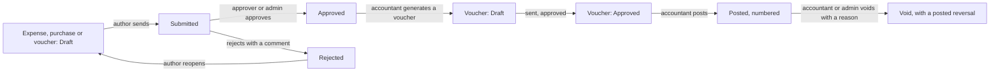

# UI flow

The screens of the web app, who sees which, and how a person gets from one to the next. Kept current as screens are built.
The design is monochrome and soft (`decisions.md`, 130 to 139): white cards with a soft shadow on a light grey page, near-black
pills for the primary action and the current place, large radii, Inter Tight for the interface and Inter for tables and figures,
and colour only where it means something (status chips, type chips, charts).

## The frame

Every signed-in screen sits in one frame.

- **Sidebar.** A floating white card. Lists only what the signed-in role may open. It folds to a strip of icons (the arrow at
  the foot or in the top bar); the choice is remembered in a cookie so the page is drawn the right way on first paint. Its own
  thin scrollbar appears when the list is long. The logo draws itself in when the page loads. On a phone it becomes a drawer
  opened from the menu button and closed by choosing a place, the scrim or Escape.
- **Top bar.** The fold button on the left; on the right a dark "New" menu (expense, purchase, voucher, only what the role may
  write), the notification bell (what is waiting for this person, counted from the same lists as the home screen), the light and
  dark theme toggle, the Help center, and the account menu (Help center, change password, sign out).
- **Content.** A page header (title, what it is for, the actions), then white cards. Lists show a search box, the status as
  pills and a Filters panel; the filters in use appear as removable chips. A row that leads somewhere is pressable and ends in an
  arrow. Long text is cut with an ellipsis and shown whole on hover. Every data surface has a skeleton while it loads, and empty
  and error states.
- **New documents** open in a modal over the current screen with the page behind it blurred (`?new=expense`, `?new=purchase`,
  `?new=voucher`); saving moves to the new document.

## Who sees what

| Screen | Path | Admin | Accountant | Approver | Staff |
|---|---|---|---|---|---|
| Home (work waiting, figures, charts) | `/` | yes | yes | yes | yes (own work, no charts) |
| Help center | `/help` | yes | yes | yes | yes |
| Approvals queue | `/approvals` | yes | no | yes | no |
| Expenses: list, new, edit, detail | `/expenses`, `/expenses/new`, `/expenses/[id]`, `/expenses/[id]/edit` | yes | yes | read | own only |
| Purchases: list, new, edit, detail | `/purchases`, `/purchases/new`, `/purchases/[id]`, `/purchases/[id]/edit` | yes | yes | read | no |
| Vouchers: list, new, edit, detail | `/vouchers`, `/vouchers/new`, `/vouchers/[id]`, `/vouchers/[id]/edit` | yes | yes | read | no |
| Reports and CSV | `/reports` | yes | yes | yes | no |
| Vendors | `/vendors` | edit | edit | read | no |
| Chart of accounts | `/accounts` | edit | edit | read | no |
| Categories, cost centres, projects | `/categories`, `/cost-centers`, `/projects` | edit | edit | read | no |
| Tax rates | `/tax-rules` | edit | edit | read | no |
| Accounting periods | `/periods` | close, reopen | read | read | no |
| Accounting settings (numbering year, posting accounts) | `/settings` | edit | edit | read | no |
| Users and invitations | `/users` | yes | no | no | no |
| Audit log | `/audit` | yes | no | no | no |
| Your account (password) | `/profile` | yes | yes | yes | yes |

A screen a role may not use shows "Your role does not include this screen". That is courtesy: the API refuses the same calls.

## Public screens

One 50/50 layout (an illustrated half and the form, each a rounded card; the illustration goes and the panel shrinks to a header on a narrow screen). The left half is a flat illustration of two people at a giant open ledger. Signed-in people are sent home from
the first two.

| Screen | Path | What it does |
|---|---|---|
| Sign in | `/login` | Email and password. A rate-limited attempt shows a countdown. With `DEMO_MODE` on, the four demonstration accounts are listed under the form. |
| Forgot password | `/forgot-password` | Always says the same thing, whether or not the address has an account. |
| Reset password | `/reset-password?token=` | One-time link from the email; signs out every device. |
| Accept invitation | `/accept-invite?token=` | Shows the address and role, asks for a name and password. |

## How a document moves

- An expense or purchase is written and edited on its form (`new`, `edit`), judged on its detail screen, and turned into a voucher
  from the detail screen once approved (an expense in one click; a purchase asks for the expense category and how it was paid).
- A voucher is posted from its detail screen, which asks first and gives the permanent number. Posting it posts its source.
- A void asks for a reason, posts the reversing voucher at once, and leaves the source posted. The correction is a new document.

## Document detail screens

All three kinds share one layout: the document on the left, and a margin rail on the right holding its status, its voucher or
source, who wrote it and when, and its history. The actions that apply to this person right now (send, approve, reject, reopen,
post, void) come from the API in `actions`, and sit above the details so they stay reachable. A refusal that lists what is
missing is shown under the buttons. The rail stays in view while the page scrolls, and drops under the document on a narrow
screen. Printing a voucher hides the frame and adds signature lines.

## The three editors

- **Expense form.** Direct (one cost centre, project or product) or indirect (a split). The split editor asks the server what
  each cost centre would be charged as lines are typed, and shows how much is still unallocated. Receipts can be added before
  saving.
- **Purchase form.** A vendor, a date, the invoice number (required from a registered vendor), and a grid of lines. The server
  prices every line as you type; the tax columns are shaded because they are not for typing in.
- **Voucher editor.** Lines are typed like a spreadsheet: Tab moves across, Enter in an amount goes to the next line and opens one
  after the last. The strip at the foot always shows debit, credit and the difference, and one button adds the exact line that
  balances. The save buttons say why they are disabled.

## Keyboard

Everything is reachable with the keyboard. Focus is always visible. Dialogs and the tour trap focus and return it. Escape closes a
dialog, the account menu, the phone drawer and ends the tour. Tab order follows reading order; the voucher editor's own keys are
described above.

## The home screen

Cards, most important first. Office roles: a dark "Waiting for you" card, the month's spend as the large figure, then counts for
expenses, purchases and posted vouchers; then the work lists (each with its count, red when it needs action); then the charts:
spend by month (expenses and purchases side by side), where documents stand (a stacked bar per kind), and spend by cost centre.
Every chart has a Table button with the same numbers, and shows a tooltip on hover and keyboard focus. Staff see their own three
lists as cards: sent back, drafts, waiting for approval.

## The Help center

`/help`: a guide written for the signed-in role (what they do here, in order), how a document moves, a card for every screen they
can open, and a few tips. It is the only place the tour can be started again.

## The tour

Five to seven steps chosen for the role and written for the person: their name, their role, and what is waiting for them right
now. "Step 2 of 5" is shown, and Skip is always visible; Escape ends it. It starts by itself on first sign-in and is saved on the
server, so it does not reappear on another device; it can be started again only from the Help center. The card is our own (white,
dark text, clear buttons) in both themes. On a narrow screen the steps that point into the sidebar are left out.
