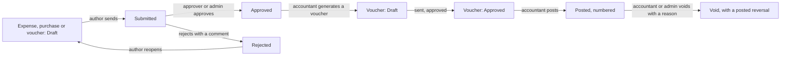

# UI flow

The screens of the web app, who sees which, and how a person gets from one to the next. Kept current as screens are built.
The design is the "Ledger" direction (`decisions.md`, 120 and 122): ruled sheets, tabular figures, stamps for statuses, a
dashboard frame with a sidebar that folds to icons.

## The frame

Every signed-in screen sits in one frame.

- **Sidebar.** Lists only what the signed-in role may open. It folds to a strip of icons (the button at the bottom or in the
  top bar); the choice is remembered in a cookie so the page is drawn the right way on first paint. On a phone it becomes a
  drawer opened from the menu button and closed by choosing a place, the scrim or Escape.
- **Top bar.** The fold button and the account menu: theme (System, Light, Dark), row density (Compact, Comfortable), take the
  tour, change password, sign out.
- **Content.** A page header (title, what it is for, the actions), then ruled panels. Lists put filters, sort and page in the
  address bar, show the filters in use as removable chips, and every data surface has loading, empty and error states.

## Who sees what

| Screen | Path | Admin | Accountant | Approver | Staff |
|---|---|---|---|---|---|
| Home (work waiting, month so far) | `/` | yes | yes | yes | yes (own work) |
| Approvals queue | `/approvals` | yes | no | yes | no |
| Expenses: list, new, edit, detail | `/expenses`, `/expenses/new`, `/expenses/[id]`, `/expenses/[id]/edit` | yes | yes | read | own only |
| Purchases: list, new, edit, detail | `/purchases`, `/purchases/new`, `/purchases/[id]`, `/purchases/[id]/edit` | yes | yes | read | no |
| Vouchers: list, new, edit, detail | `/vouchers`, `/vouchers/new`, `/vouchers/[id]`, `/vouchers/[id]/edit` | yes | yes | read | no |
| Reports and CSV | `/reports` | yes | yes | yes | no |
| Vendors | `/vendors` | edit | edit | read | no |
| Chart of accounts | `/accounts` | edit | edit | read | no |
| Categories, cost centres, projects | `/categories`, `/cost-centers`, `/projects` | edit | edit | read | no |
| Tax rates | `/tax-rules` | edit | edit | read | no |
| Accounting periods | `/periods` | close, reopen | read | read | no |
| Accounting settings (numbering year, posting accounts) | `/settings` | edit | edit | read | no |
| Users and invitations | `/users` | yes | no | no | no |
| Audit log | `/audit` | yes | no | no | no |
| Your account (password) | `/profile` | yes | yes | yes | yes |

A screen a role may not use shows "Your role does not include this screen". That is courtesy: the API refuses the same calls.

## Public screens

One 50/50 layout (brand panel and form; the panel shrinks to a header on a narrow screen). Signed-in people are sent home from
the first two.

| Screen | Path | What it does |
|---|---|---|
| Sign in | `/login` | Email and password. A rate-limited attempt shows a countdown. With `DEMO_MODE` on, the four demonstration accounts are listed under the form. |
| Forgot password | `/forgot-password` | Always says the same thing, whether or not the address has an account. |
| Reset password | `/reset-password?token=` | One-time link from the email; signs out every device. |
| Accept invitation | `/accept-invite?token=` | Shows the address and role, asks for a name and password. |

## How a document moves

- An expense or purchase is written and edited on its form (`new`, `edit`), judged on its detail screen, and turned into a voucher
  from the detail screen once approved (an expense in one click; a purchase asks for the expense category and how it was paid).
- A voucher is posted from its detail screen, which asks first and gives the permanent number. Posting it posts its source.
- A void asks for a reason, posts the reversing voucher at once, and leaves the source posted. The correction is a new document.

## Document detail screens

All three kinds share one layout: the document on the left, and a margin rail on the right holding its status, its voucher or
source, who wrote it and when, and its history. The actions that apply to this person right now (send, approve, reject, reopen,
post, void) come from the API in `actions`, and sit above the details so they stay reachable. A refusal that lists what is
missing is shown under the buttons. The rail stays in view while the page scrolls, and drops under the document on a narrow
screen. Printing a voucher hides the frame and adds signature lines.

## The three editors

- **Expense form.** Direct (one cost centre, project or product) or indirect (a split). The split editor asks the server what
  each cost centre would be charged as lines are typed, and shows how much is still unallocated. Receipts can be added before
  saving.
- **Purchase form.** A vendor, a date, the invoice number (required from a registered vendor), and a grid of lines. The server
  prices every line as you type; the tax columns are shaded because they are not for typing in.
- **Voucher editor.** Lines are typed like a spreadsheet: Tab moves across, Enter in an amount goes to the next line and opens one
  after the last. The strip at the foot always shows debit, credit and the difference, and one button adds the exact line that
  balances. The save buttons say why they are disabled.

## Keyboard

Everything is reachable with the keyboard. Focus is always visible. Dialogs and the tour trap focus and return it. Escape closes a
dialog, the account menu, the mobile drawer and ends the tour. Tab order follows reading order; the voucher editor's own keys are
described above.

## The tour

Five or six steps chosen for the role, one sentence and one pointer each, with "Step 2 of 5" shown. Skip is always visible; Escape
ends it; finishing or skipping is saved on the server, so it does not reappear on another device. It starts by itself on first
sign-in and again from "Take the tour" in the account menu. On a narrow screen the steps that point into the sidebar are left out.
